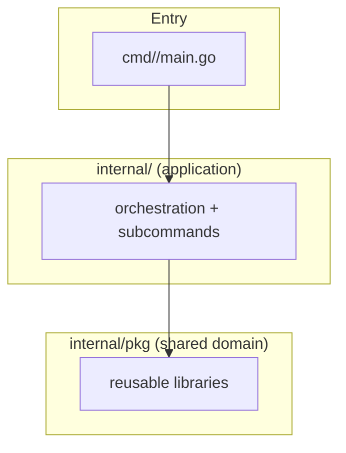

# AiT Project Structure

This document is the structure overview for the AiT repository: what lives where, why the layering exists, and how to extend it safely. It does **not** document tool-specific implementation details.

---

## 1. What is AiT

AiT is a Go CLI toolbox.  
Go module path: `github.com/os-artificer/AiT`.

Shipped tools (binary / plugin command; docs may use legacy product titles such as aissh):

- `ait`: Agent interaction entry — bare `ait` / `ait agent` starts the Agent Loop; `ait shell` is the toolbox REPL; top-level plugin dispatch (`ait ssh`, `ait log`, …).
- `aitssh` (`ssh`): SSH client with session persistence, transfer support, and shell/meta workflows (**no AI subtree**); Go package `aissh`.
- `aitimg` (`img`): Image metadata extractor (EXIF device/time/GPS + Nominatim reverse-geocoded address).
- `aitlog` (`log`): System log viewer and search (Linux/macOS/Windows) with native tools and built-in fallbacks.
- `aithost` (`host`): Live host CPU, memory, disk, network, TCP/UDP/ARP/ICMP, and process monitor (Bubble Tea dashboard).
- `aitkeep` (`keep`): Process supervisor with `GET /ping` and CPU, memory, and disk limits.

Shared capabilities (not separate binaries) live under `internal/pkg/` and are consumed by tools. Agent Loop kernel is `internal/pkg/agentcore` (engine: `internal/pkg/ai`; ops toolbox: `agentops` + `tooldispatch`; wire: `agentwire`; UI: `agentui`). Admin CLI and connect live in `internal/ait/agent`; routing in `internal/ait/router`.

---

## 2. Documentation map

| Document | Purpose |
| -------- | ------- |
| [architecture.md](architecture.md) | Toolbox structure and generic layering rules (this page) |
| [tools/ait.md](tools/ait.md) | `ait` user guide |
| [tools/ait-internals.md](tools/ait-internals.md) | `ait` implementation (plugin discovery) |
| [tools/aissh.md](tools/aissh.md) | `aissh` user guide (CLI, prompts, behavior) |
| [tools/aissh-internals.md](tools/aissh-internals.md) | `aissh` implementation (package layering, workflows, source map) |
| [tools/aiimg.md](tools/aiimg.md) | `aiimg` user guide |
| [tools/aiimg-internals.md](tools/aiimg-internals.md) | `aiimg` implementation (package layering) |
| [tools/ailog.md](tools/ailog.md) | `ailog` user guide |
| [tools/ailog-internals.md](tools/ailog-internals.md) | `ailog` implementation (package layering) |
| [tools/aihost.md](tools/aihost.md) | `aihost` user guide |
| [tools/aihost-internals.md](tools/aihost-internals.md) | `aihost` implementation (package layering) |
| [tools/aitkeep.md](tools/aitkeep.md) | `aitkeep` user guide |
| [tools/aitkeep-internals.md](tools/aitkeep-internals.md) | `aitkeep` implementation (package `keepalive`) |
| [AGENTS.md](../AGENTS.md) | Agent-oriented build/test/layout orientation |
| [CONTRIBUTING.md](../CONTRIBUTING.md) | Contributor workflow and coding standards |
| [change-acceptance.mdc](../.cursor/rules/change-acceptance.mdc) | Merge gates and regression acceptance checklist |
| [testenv-mock.md](testenv-mock.md) | In-repo loopback SSH+HTTP mocks for automated acceptance |

---

## 3. Tools catalog

| Tool (docs) | Status  | Entry binary | Plugin | App package | User guide | Internals |
| -------- | ------- | ------------ | ------ | ----------------- | ---------------------------------- | ------------------------------------------------------ |
| `ait` | Shipped | `bin/ait` | — | `internal/ait` (+ `internal/ait/agent`) | [tools/ait.md](tools/ait.md) | [tools/ait-internals.md](tools/ait-internals.md) |
| aissh | Shipped | `bin/aitssh` | `ssh` | `internal/ssh` (package `aissh`) | [tools/aissh.md](tools/aissh.md) | [tools/aissh-internals.md](tools/aissh-internals.md) |
| aiimg | Shipped | `bin/aitimg` | `img` | `internal/img` | [tools/aiimg.md](tools/aiimg.md) | [tools/aiimg-internals.md](tools/aiimg-internals.md) |
| ailog | Shipped | `bin/aitlog` | `log` | `internal/log` | [tools/ailog.md](tools/ailog.md) | [tools/ailog-internals.md](tools/ailog-internals.md) |
| aihost | Shipped | `bin/aithost` | `host` | `internal/host` | [tools/aihost.md](tools/aihost.md) | [tools/aihost-internals.md](tools/aihost-internals.md) |
| `aitkeep` | Shipped | `bin/aitkeep` | `keep` | `internal/pkg/keepalive` | [tools/aitkeep.md](tools/aitkeep.md) | [tools/aitkeep-internals.md](tools/aitkeep-internals.md) |

AiT is intentionally toolbox-first: each tool gets a thin `cmd/<dir>/main.go` entry (`cmd/ssh`, `cmd/host`, …), an app layer under `internal/<app>/` (or `internal/pkg/keepalive` for aitkeep), and shared primitives in `internal/pkg/*`.  
Agent admin lives under `internal/ait/agent`. The toolbox ships `ait`, `aitssh`, `aitimg`, `aitlog`, `aithost`, and `aitkeep`. `aitkeep` keeps its CLI in `internal/pkg/keepalive` (package `keepalive`); `cmd/keep` only calls `keepalive.Run`.

---

## 4. Repository layout

| Path              | Role                                                                 |
| ----------------- | -------------------------------------------------------------------- |
| `cmd/`            | Binary entrypoints; each tool has a minimal `main`                   |
| `internal/<app>/` | Application layer for one toolbox tool (orchestration + subcommands) |
| `internal/pkg/`   | Shared module-private libraries reused by app packages               |
| `pkg/`            | Public importable packages for external consumers                    |
| `mock/`           | Test-only loopback mocks (SSH/HTTP/Releases) and daemon mains        |
| `mock/testssh/`   | Loopback mock sshd + SFTP for automated acceptance                   |
| `mock/testhttp/`  | Loopback mock OpenAI / Ollama / Nominatim HTTP                       |
| `mock/testrelease/` | httptest GitHub Releases fixture (`mock/aitrelease-mock`)            |
| `mock/testenv-mock/` | Test-only loopback SSH+HTTP mock daemon (JSON banner)             |
| `configs/`        | Example configuration files                                          |
| `docs/`           | Architecture, tool docs, and project docs                            |
| `docs/tools/`     | Per-tool user guides and internals documents                         |

Practical split:

- `cmd` should stay tiny.
- `internal/<app>` owns that tool's user-facing behavior and command composition.
- `internal/pkg` owns reusable implementation details that are not tied to one subcommand package.
- `pkg` is for external reuse and should remain product-agnostic.

---

## 5. Toolbox layer diagram

Tool-specific layer diagrams and module names live in each tool's internals document (for `aissh`, see [tools/aissh-internals.md](tools/aissh-internals.md)).

---

## 6. Layer rules

| Layer         | Paths                                      | Allowed imports                                              |
| ------------- | ------------------------------------------ | ------------------------------------------------------------ |
| Entry         | `cmd/<tool>`                               | Tool app package only                                        |
| Application   | `internal/<app>/`, `internal/<app>/<cmd>/` | `internal/pkg/*`, never the reverse direction                |
| Shared domain | `internal/pkg/*`                           | Other `internal/pkg/*`; must not import any `internal/<app>` |
| Public libs   | `pkg/*`                                    | Generic dependencies; avoid AiT product coupling             |

Hard constraints:

- Import direction flows downward (`cmd` → `internal/<app>` → `internal/pkg`).
- `internal/pkg` is never allowed to depend on application packages under `internal/<app>`.
- New top-level behavior should not require editing unrelated command packages.

---

## 7. Cross-cutting concerns

- **Keyring first:** SSH/API secrets should remain outside SQLite rows whenever possible.
- **Errhint formatting:** user-facing recoverable errors should use multi-line `errhint` style with stable `Try:` guidance.
- **Cross-platform gate:** run `make test-cross` for any change that can affect OS behavior (TTY, pathing, exec, platform tools).

---

## 8. Package layering (toolbox principles)

At the toolbox level:

1. Each tool documents its own package layering in `docs/tools/<tool>-internals.md`.
2. Application packages compose subcommands; shared logic belongs in `internal/pkg`.
3. `internal/pkg` must not import application packages.

For `aissh` call chains, registry rules, entry surfaces, and the contributor checklist, see [tools/aissh-internals.md#package-layering](tools/aissh-internals.md#package-layering). Cursor rule summary: [package-layering.mdc](../.cursor/rules/package-layering.mdc).

---

## 9. Adding a new tool

For a future toolbox tool `<tool>`:

1. Add `cmd/<tool>/main.go` with minimal delegation.
2. Add `internal/<tool>/` as the application layer for that tool.
3. Add `docs/tools/<tool>.md` (user guide) and `docs/tools/<tool>-internals.md` (implementation reference).
4. Reuse `internal/pkg/*` only for genuinely shared logic.
5. Keep cross-tool boundaries explicit to avoid coupling.

---

## 10. Related documents

| Document | Focus |
| -------- | ----- |
| [tools/aissh.md](tools/aissh.md) | `aissh` operator-facing CLI guide |
| [tools/aissh-internals.md](tools/aissh-internals.md) | `aissh` code layout and workflows |
| [tools/ait.md](tools/ait.md) | `ait` operator-facing CLI guide |
| [tools/ait-internals.md](tools/ait-internals.md) | `ait` code layout |
| [tools/aiimg.md](tools/aiimg.md) | `aiimg` operator-facing CLI guide |
| [tools/aiimg-internals.md](tools/aiimg-internals.md) | `aiimg` code layout |
| [tools/ailog.md](tools/ailog.md) | `ailog` operator-facing CLI guide |
| [tools/ailog-internals.md](tools/ailog-internals.md) | `ailog` code layout |
| [tools/aihost.md](tools/aihost.md) | `aihost` operator-facing CLI guide |
| [tools/aihost-internals.md](tools/aihost-internals.md) | `aihost` code layout |
| [tools/aitkeep.md](tools/aitkeep.md) | `aitkeep` operator-facing CLI guide |
| [tools/aitkeep-internals.md](tools/aitkeep-internals.md) | `aitkeep` code layout |
| [AGENTS.md](../AGENTS.md) | Agent entry point and codebase orientation |
| [CONTRIBUTING.md](../CONTRIBUTING.md) | Contributor process and standards |
| [change-acceptance.mdc](../.cursor/rules/change-acceptance.mdc) | Acceptance and regression checklist |
| [testenv-mock.md](testenv-mock.md) | Loopback SSH+HTTP mocks for CI acceptance |
| [go.mod](../go.mod) | Dependency and module version source |

