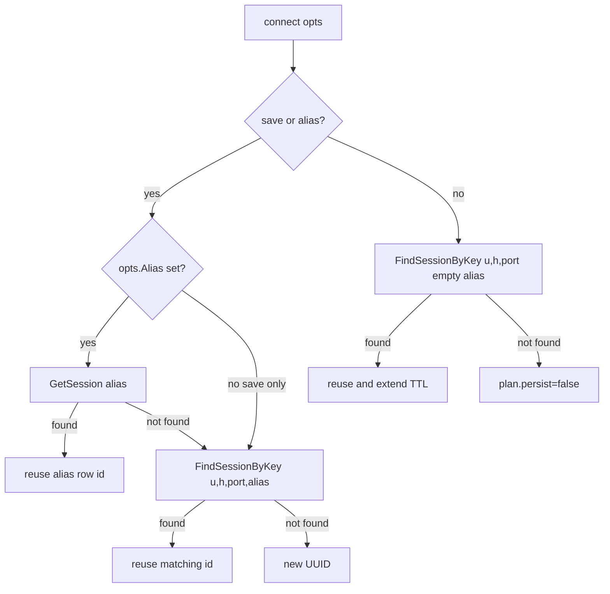

# aissh
> AiT SSH tool guide for connect, session persistence, and transfer workflows.
>
> **Names:** binary `aitssh`, plugin command `ssh` (`ait ssh …`), Go package `aissh`, docs title aissh.

## Table of contents
- [Overview](#overview)
- [CLI surface](#cli-surface)
- [Quick start](#quick-start)
- [Command reference](#command-reference)
- [Local REPL input (UTF-8)](#local-repl-input-utf-8)
- [Prompts](#prompts)
- [Security and SSH](#security-and-ssh)
- [AI configuration note](#ai-configuration-note)
- [In-session SSH commands](#in-session-ssh-commands)
- [Data directory](#data-directory)
- [Error hints](#error-hints)
- [Limitations](#limitations)
- [Proxy chain mode](#proxy-chain-mode)
- [Further reading](#further-reading)

---

## Overview

`aitssh` (docs title **aissh**) is the SSH tool in the AiT toolbox. It combines:

- OpenSSH-style connect and argument compatibility (`-p`, `-i`, `-J`, `-o`, and more)
- session persistence in SQLite with optional alias bookmarks
- optional remote `tmux` keep-alive mode
- in-session meta commands (`!ait`); no in-session AI
- standalone and in-session file transfer (`get`, `put`)
- local shell REPL with UTF-8 line editing and history

Ops AI Agent lives under **`ait agent`** — see [`ait.md`](ait.md). `aitssh` has zero AI subtree.

Toolbox structure: [`../architecture.md`](../architecture.md). Implementation details (package layering, workflows, source map): [`aissh-internals.md`](aissh-internals.md).

---

## CLI surface

```text
aitssh shell                                    # AiT> REPL (ssh-style connect, list/load, etc.)
aitssh                                          # no args: root help (not SSH connect)
aitssh [ssh-options] destination [command ...] [--save] [--alias NAME] [--password] [--tmux]
        # OpenSSH-compatible: -p -l -i -F -J -o, etc.; destination is [user@]host or a config Host alias
        # Requires local OpenSSH client (ssh -G) for config resolution; data plane is Go x/crypto/ssh
        # Persists to SQLite with --save (bookmark by id) or --alias (named save; implies --save)
        # Also updates an existing empty-alias row when the connection key matches (refreshes auth TTL)
        # With command: one-shot execution (similar to ssh host cmd); new hosts need --save or --alias
        # Legacy --host/--user remain supported for backward compatibility
aitssh session --list [-v]   # # column for pick-by-number; -v adds FULL_ID (complete UUID)
aitssh session --load [<id|alias>] [--tmux] [--password]   # Omit id to pick; id must be alias or full UUID (not list ID)
aitssh session --suspend         # Local CLI only; inside SSH use !ait suspend
aitssh session --switch [id|alias] [--tmux] [--password] [--force]  # Switch session; omit id to pick
aitssh session --delete <id|alias|all> [--force]                     # Delete one or all saved sessions
aitssh get [ssh-flags] <paths...>   # OpenSSH flags; paths/order like default SSH connect
aitssh put [ssh-flags] <paths...>
aitssh config init|view|edit|validate|set|get ...   # YAML config; edit uses $VISUAL/$EDITOR
```

**Important connect parsing note**

- First token `login` is intentionally **not** treated as SSH connect routing.
- `aitssh login ...` is unknown.
- In `aitssh shell`, typing `login ...` is also unknown.

### Two recovery modes (default vs `--tmux`)

| Mode | Trigger | `load` behavior | Remote processes |
|------|---------|-----------------|------------------|
| Default (bookmark) | No `--tmux` | Reconnect with stored connection info; optionally seed saved scrollback into memory (not redrawn to terminal) | No keep-alive guarantee |
| tmux keep-alive | connect/load with `--tmux` | After SSH: `tmux attach -t ait-<session_id>` (or `new -s` if missing) | Shell/process survives disconnect |

### Connect persistence decision (connection key includes alias)



**Persistence model summary**

- Session identity key is `username + host + port + alias`.
- Empty alias and named alias rows are distinct records.
- `--alias` implies save behavior.
- `login_destination` stores the original destination form (for example an ssh config host alias).
- Plain `aitssh user@host` only updates an existing matching **empty-alias** row; otherwise it is ephemeral.

---

## Quick start

```bash
# AI API keys (OS keyring, or encrypted files under <AppRoot>/keyring on headless Linux)
# First-time AI config (not aissh config):
./bin/ait agent config init
# On servers without D-Bus, set a master password:
export AIT_KEYRING_FILE_PASSWORD='your-secret'
./bin/ait agent config set ai.deepseek.api_key <your-key>
./bin/ait agent config set ai.minimax.api_key <your-key>   # optional second provider
# Aliases still work: deepseek.api_key, minimax.api_key

# Connect: see help for full flags
./bin/aitssh --help

# Interactive connect and persist session
./bin/aitssh deploy@example.com --alias prod
./bin/aitssh -p 22 -i ~/.ssh/id_ed25519 deploy@10.0.0.5
./bin/aitssh -J bastion app.internal

# One-shot remote command (like ssh host cmd; not persisted for a new host by default)
./bin/aitssh deploy@example.com uptime

# List, restore, switch sessions
./bin/aitssh session --list
./bin/aitssh session --list -v
./bin/aitssh session --load
./bin/aitssh session --load prod
./bin/aitssh session --switch staging

# File transfer (OpenSSH flags; paths and flags in any order)
./bin/aitssh get -p22 -i~/.ssh/id ./app.log user@deploy:/var/log/app.log
./bin/aitssh get deploy@10.0.0.5 /var/log/app.log ./app.log
./bin/aitssh get ./app.log /var/log/app.log --session prod
./bin/aitssh put -l root ./bin/app user@host:/usr/local/bin/app
```

Optional template bootstrap:

```bash
./bin/aitssh config init
# Or manually copy:
mkdir -p ~/.local/share/ait
cp ../../configs/ait.example.yaml ~/.local/share/ait/config.yaml
```

---

## Command reference

| Command | Description |
|---------|-------------|
| `aitssh shell` | Interactive local REPL (`AiT>`): builtins first, then `<AppRoot>/bin`, then `aitssh` CLI, then PATH, then narrow connect routing |
| `aitssh [flags] destination` | OpenSSH-style connect (`aitssh user@host`, `aitssh -J jump final`); `--save` or `--alias` persists |
| `aitssh session --list` | List saved sessions (`#` display column; use `-v` for `FULL_ID`) |
| `aitssh session --load [<id\|alias>]` | Restore session; omit id to pick; use alias or full UUID, not short list ID |
| `aitssh session --suspend` | Local CLI suspend; in-session use `!ait suspend` |
| `aitssh session --switch [id\|alias]` | Switch session; blocked if current is active unless `--force` |
| `aitssh session --delete <id\|alias>` | Delete one session |
| `aitssh session --delete all` | Delete all sessions (confirmation unless `--force`) |
| `aitssh get [flags] <paths...>` | Download one file |
| `aitssh put [flags] <paths...>` | Upload one file |
| `aitssh config init [--dry-run]` | Create/merge `config.yaml` with missing keys |
| `aitssh config view` | Print config YAML (creates when missing) |
| `aitssh config edit` | Open editor (`$VISUAL`/`$EDITOR`) and validate |
| `aitssh config validate` | Validate syntax and values; exits non-zero on errors |
| `aitssh config set/get <key>` | Get/set session config values |

Common flags:

- `--tmux` remote keep-alive mode
- `--port`, `--identity`, `--password`, `--alias`
- `session --switch --force` for switching while current session is still active

---

## Local REPL input (UTF-8)

Local REPL behavior applies to `aitssh shell`.

### Platform support

- macOS/Linux: set UTF-8 locale, for example `LANG=en_US.UTF-8`
- Windows: prefer Windows Terminal; set UTF-8 (`chcp 65001` for legacy consoles)
- IME composition is handled by terminal; committed text arrives as UTF-8 bytes

### Editing and keys

- Ctrl+A / Ctrl+E: move to start/end
- Left/Right: move cursor
- Up/Down: history recall
- Ctrl+R: reverse incremental history search
- Ctrl+U/Ctrl+K/Ctrl+W: kill line/to-end/word
- Backspace, Tab insertion
- Ctrl+C: cancel current line
- Ctrl+D: exit when line empty
- Ctrl+L: clear screen and redraw prompt/buffer in TTY

### History

- History is command input history.
- Confirm prompts (`[y/N]`), picker input, and internal setup lines do not pollute command history.
- History persists across sessions in `<AppRoot>/repl_history` (mode `0600`).
- `history` command supports bash-like subset: list, `history n`, `-c`, `-d`, `-s`, `-a`, `-r`, `-w`.

### Clear behavior

- `aitssh shell`: `clear` command and Ctrl+L clear terminal display.

### Scope boundary

- SSH session editing (top-level connect/load) uses remote shell editing.
- `!ait local` uses local shell editing inside the remote session tunnel.

---

## Prompts

| Context | Prompt |
|---------|--------|
| `aitssh shell` | `AiT> ` |
| SSH remote | `AiT user@host:dir[:git-branch]> ` |
| SSH nested | same format on active nested host |
| `!ait local` | `AiT Local> ` |

Prompt path mode is controlled by `session.remote_prompt.path`:

- `short` (default): final path segment
- `absolute`: full path with `~` home replacement

Expected connect/load UX:

- After `aitssh user@host` or `aitssh session --load`, the remote `AiT user@host:...>` prompt should appear immediately.
- No extra Enter should be required to reveal first prompt.
- Default is AiT-managed remote prompt. Set `AIT_REMOTE_SYSTEM_PROMPT=1` to keep the remote shell's native prompt instead (meta/`!ait` still work; nested `ssh` still auto-enables chain mode).

---

## Security and SSH

- Known-host verification is enabled by default (`~/.ssh/known_hosts`).
- For new hosts, add keys before connect (for example `ssh-keyscan -H host >> ~/.ssh/known_hosts`).
- `AIT_SSH_INSECURE=1` is development-only and should not be used in production.
- `--password` may appear in process listing; prefer keyring and interactive secret entry.

Credential storage model:

- SSH secrets and AI API keys (for `ait` / `ait agent`): keyring-backed
- SQLite stores metadata and key paths, not plaintext SSH passwords
- file-based encrypted keyring fallback under `<AppRoot>/keyring` for headless setups

---

## AI configuration note

`aitssh` does **not** run AI. Use **`ait`** / **`ait agent`** for the Agent Loop and **`ait agent connect`** for remote sessions. Configure `ai.*` with **`ait agent config`** (see the quick start above and [`ait.md`](ait.md)). AI is on by default. Turn it off with `ai.experimental.enabled false` or `AIT_AI_EXPERIMENTAL=0`.

---

## In-session SSH commands

Meta prefix inside SSH is `!ait` (not `!aitssh`).

| Input | Action |
|-------|--------|
| `!ait` / `!ait help` | print in-session help |
| `!ait <subcmd> ...` | run supported local `aitssh` subcommands |
| `!ait [flags] dest` | auto-persist if needed, suspend current, connect target |
| `!ait load [id\|alias]` | auto-persist if needed, suspend current, load target |
| `!ait session --switch [id\|alias]` | auto-persist if needed, suspend current, switch |
| `!ait local` | enter local mode |
| `!ait remote` | leave local mode |
| `!ait suspend` | suspend current session |
| `!ait get <remote> [local]` | in-session download through current SSH connection |
| `!ait put <local> [remote]` | in-session upload through current SSH connection |
| `!ait chain [on\|off]` | toggle chain mode |

Detection and routing notes:

- meta lines are scanned at byte-level and do not go to remote shell stdin
- `!ait list` is rewritten to `session --list`

---

## Data directory

All runtime files are under one `AppRoot` directory.

| Platform | Default `AppRoot` |
|----------|-------------------|
| Linux | `~/.local/share/ait/` |
| macOS | `~/Library/Application Support/ait/` |
| Windows | `%LOCALAPPDATA%\ait\` |

Overrides:

- `AIT_HOME`
- `AIT_DATA_DIR` (used when `AIT_HOME` is unset)

Runtime layout:

```text
<AppRoot>/
├── config.yaml       # main YAML config
├── ait.db            # SQLite session store
├── repl_history      # local REPL input history
├── scrollback/       # per-session scrollback sidecars
├── keyring/          # encrypted file keyring fallback
└── ollama/models/    # recommended local models directory
```

Operational notes:

- `aitssh config init` creates/merges missing config keys.
- `aitssh config view` prints current config (creates file if missing).
- `aitssh config edit` opens editor and validates on save.
- `aitssh config validate` checks syntax and value constraints.

---

## Error hints

Most user-facing validation and routing errors include a multi-line `Try:` block.

| Situation | Typical hint |
|-----------|--------------|
| `session --load` with short display ID | display ID is not load target; use alias or full UUID (`-v`) |
| `session --switch` while active session still attached | suspend in-session (`!ait suspend`) or use `--force` |
| unknown config key | suggest valid key paths and config get/set examples |
| `config validate` failure | includes field paths and reason |
| missing config for validate | run `aitssh config init` first |
| editor unavailable for `config edit` | set `EDITOR` / `VISUAL` |

Formatting behavior:

- CLI stderr keeps structured message and `Try:` examples
- in TTY, multi-line formatting is preserved with CRLF-safe output paths

---

## Limitations

- Without `--tmux`, remote processes are not guaranteed to survive suspend/disconnect.
- `aitssh get` and `aitssh put` are single-file transfers (not directory recursion).
- In-session `!ait put` local path is on the AiT client machine, not remote cwd.
- Progress output is optimized for TTY; non-TTY logs are still phase-oriented but not interactive refresh.
- chain ZMODEM depends on remote `lrzsz` (`sz`, `rz`) availability in chain mode.
- very large scrollback capture increases memory and sidecar I/O overhead.
- Windows PTY and shell combinations can have environment-specific edge cases.

Risk watch items:

- chain-mode transfer reliability depends on active shell and remote utility behavior
- huge scrollback sessions can impact replay and sanitize costs
- cross-shell prompt behavior (especially customized zsh themes) can still need environment tuning

---

## Proxy chain mode

`ProxyJump` on connect is not the same as in-session chain mode.

### Direct connect path

- `aitssh -J jump final` dials the final host through jump chain (OpenSSH-compatible: each `-J` hop is resolved via `ssh -G`, including `Host` aliases such as `devhost`).
- Jump SSH clients stay open for the lifetime of the final connection (required for direct-tcpip forwarding).
- For this direct dial target, in-session transfer prefers direct path behavior.

### Chain mode trigger

Chain mode is for deeper interactive hops, usually after manual nested `ssh` in a running AiT session.

- after nested `ssh` settles (MOTD/prompt quiet, including idle shells), AiT updates the active host and turns chain **on** automatically
- if active shell host differs from dial target, `!ait get`/`!ait put` can auto-enable chain mode
- manual control: `!ait chain on` / `!ait chain off`

### Effect of chain mode

- transfer backend switches to PTY-pipe injection route
- tmux remote operations also route through PTY injection
- scrollback continues to work in both direct and chain states

### Requirements

- active shell in chain mode needs `lrzsz` (`sz`, `rz`) for ZMODEM transfer
- if missing, AiT can provide install hints and interactive `[y/N]` install flow

---

## Further reading

| Document | Description |
|----------|-------------|
| [`../architecture.md`](../architecture.md) | AiT toolbox project structure |
| [`aissh-internals.md`](aissh-internals.md) | Package layering, workflows, and source map |
| [`ait.md`](ait.md) | Agent Loop and `ait agent` |
| [`../../AGENTS.md`](../../AGENTS.md) | Codebase orientation and package responsibilities |
| [`../../CONTRIBUTING.md`](../../CONTRIBUTING.md) | Development workflow and coding standards |
| [`../../README.md`](../../README.md) | Project overview and setup |
